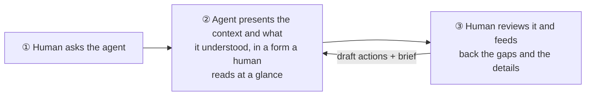

# dev-process-kit

[](https://www.npmjs.com/package/dev-process-kit)
[](https://www.npmjs.com/package/dev-process-kit?activeTab=versions)
[](https://www.jsdelivr.com/package/npm/dev-process-kit)
[](https://github.com/d-kimuson/dev-process-kit/actions/workflows/ci.yml)
[](https://d-kimuson.github.io/dev-process-kit/)
[](LICENSE)
<br />
[](docs/index.md)
[](skills/dev-process-kit/SKILL.md)
[](#install-the-skill)

**A one-page design system for the documents an agent writes and a human reviews.**

An agent generates one HTML file; a human opens it, reads it, and leaves the review as
structured change requests; the agent applies them and rewrites the same file. dev-process-kit
ships the shell, the review loop, and the parts the page is made of — tokens, CSS atoms,
components, views and boards — as Web Components, with no build step.

## What you get

### A design system for one page

- **Tokens and CSS atoms** for the things a page is made of: layout (stack, cluster, grid,
  toolbar), controls (buttons, fields, menus, segmented controls, selects, comboboxes), surfaces
  (cards, callouts, tables, data tables), and data display (timeline, status, chart, meter).
- **Components** that compose them: review rail, inline editing, tables and matrices, checklists,
  tabs, dialogs, tag filters, commentable sections, mocks.
- **One consistent look**, light and dark, from the same tokens. Your own page CSS still wins.
- **No build.** One `<script type="module">` and the elements are there.

### Views: the whole page

A **view** owns the whole page and cannot be embedded. Pick the one whose subject is what you
need to agree on with the reader.

| View               | Element                     | What it is                                                                                                      |
| ------------------ | --------------------------- | --------------------------------------------------------------------------------------------------------------- |
| User Story Mapping | `dpk-view-usm`              | Scope, steps, stories and releases on one map; milestones, dependencies, labels and a burndown                  |
| UX Prototype       | `dpk-view-prototype`        | Screen flow and what each step looks like: activities, stories, steps, screens and previews                     |
| Slides             | `dpk-view-slides`           | A deck paged through one slide at a time                                                                        |
| Task Context Board | `dpk-view-task-board`       | Design docs and the tasks under them: Markdown design docs, a Kanban of todos, proposals, outputs and questions |
| Delegation Poker   | `dpk-view-delegation-poker` | Management 3.0 delegation poker: seven levels per decision area, settled on one agreed level per row            |
| Plain              | `dpk-view-plain`            | A titled page with no domain of its own: your markup and comments, for anything no other view fits              |

### Boards: embed one, or make it the page

A **board** is a self-contained visual surface. It can be embedded inside a view, and it can be
the content of a page. That is one element used two ways, not two kinds of element.

| Board            | Element                      | What it is                                                                                                |
| ---------------- | ---------------------------- | --------------------------------------------------------------------------------------------------------- |
| ER diagram       | `dpk-board-er-diagram`       | What changed between two schema snapshots                                                                 |
| State diagram    | `dpk-board-state-diagram`    | Which states exist, and what moves between them                                                           |
| Sequence diagram | `dpk-board-sequence-diagram` | In what order participants talk                                                                           |
| Dependency graph | `dpk-board-dependency-graph` | What depends on what, and what is circular                                                                |
| Architecture map | `dpk-board-architecture-map` | Which services exist, in which boundary                                                                   |
| Mind map         | `dpk-board-mind-map`         | A central topic and its subtopics, fanned out left and right, with folding                                |
| Event Storming   | `dpk-board-event-storming`   | Sticky notes on swimlanes in timeline order, with causality links                                         |
| Example Mapping  | `dpk-board-example-mapping`  | One story per column, rules beneath it, examples beneath each rule, questions pinned to any of them       |
| Whiteboard       | `dpk-board-whiteboard`       | Sticky notes, text, shapes and titled frames on a pannable, zoomable canvas, joined by labeled connectors |
| Kanban           | `dpk-board-kanban`           | Columns of cards with WIP limits; reviewers move and add cards as draft actions                           |

### Components

Components are the pieces you combine inside a view, a board or your own markup. They never fill
a page by themselves: the review rail (`dpk-comment-panel`), inline editing (`dpk-inline-edit`),
formal specs (`dpk-formal-spec`), tables and matrices (`dpk-table`, `dpk-matrix`), selects and
comboboxes (`dpk-select`, `dpk-combobox`), checklists, tabs, dialogs, tag filters, commentable
sections and the comment popover/thread, mocks and the CSS atoms. Each has a page under
[`docs/components/`](docs/components/) and [`docs/boards/`](docs/boards/).

## The review loop

The page is not a picture: the reader operates it, and the operations are the review.

- **Draft actions.** Moving a card, renaming a step, adding a todo or changing a relation is
  recorded as a structured action. The page never mutates its own base data; the agent applies
  the actions and writes the next version of the HTML.
- **Comments.** The reader comments on the page as a whole (`app:app`), on a view's element, or
  on a board's node, field or edge. A comment on something that is gone stays in the draft as
  stale instead of disappearing.
- **One draft per document.** A page with several boards — scope, domain, screens — has one
  header, one review, one draft and one brief for all of them.
- **Ask, don't just show.** Any page can carry questions (`data-dpk-grill`) for the reader to
  answer; they are a core feature of the shell, not a view of their own.
- **Hand-off.** **Copy changes & comments** puts readable markdown plus the canonical draft JSON
  on the clipboard. In a Claude Artifact it becomes **Send to Claude**, one click back to the
  session that published the page.

## The shape

```html
<dpk-app storage-key="checkout-review">
  <script type="application/json">
    { "title": "Checkout review" }
  </script>

  <dpk-page name="scope" label="Scope">
    <dpk-view-usm>
      <script type="application/json">
        { ...base data... }
      </script>
    </dpk-view-usm>
  </dpk-page>

  <dpk-page name="domain" label="Domain">
    <dpk-board-event-storming>
      <script type="application/json">
        { ...base data... }
      </script>
    </dpk-board-event-storming>
  </dpk-page>

  <dpk-page name="notes" label="Notes">
    <dpk-view-plain>
      <script type="application/json">
        { "sections": [{ "id": "decision", "title": "Decision" }] }
      </script>
      <section slot="main" data-dpk-target="section:decision">...</section>
    </dpk-view-plain>
  </dpk-page>
</dpk-app>
```

- **`<dpk-app>`** — one per HTML file. The header, the review, one draft, one storage record,
  the hash and undo/redo.
- **`<dpk-page name="…">`** — one switchable subject. It holds exactly one view or board.
- **A view or a board** — the page's content. A board inside a view is embedded; a board directly
  inside a page is the page.
- **Components** — inside the content or your own markup.

Tags are the public contract; Lit is an implementation detail. Targets are `type:id@page`
(`story:checkout.pay@scope`), the hash is `#page=scope&scope.activity=signup`, and the
document-wide target is `app:app`. There are no compatibility aliases with the older
template-and-board tags.

## Load it

Load one entry from jsDelivr, with the version pinned. A page has to keep working when a new
version is published, so never generate HTML against a floating URL such as `@latest`.

| Entry                                                                                                                              | Use it when                                       |
| ---------------------------------------------------------------------------------------------------------------------------------- | ------------------------------------------------- |
| `views/usm.js` / `views/prototype.js` / `views/plain.js` / `views/slides.js` / `views/task-board.js` / `views/delegation-poker.js` | the page is that view                             |
| `boards.js`                                                                                                                        | the page uses a board, embedded or as its content |
| `components.js`                                                                                                                    | the page uses components without a view           |
| `index.js`                                                                                                                         | one URL for everything                            |

```html
<script type="module" src="https://cdn.jsdelivr.net/npm/dev-process-kit@<version>/dist/views/usm.js"></script>
<script type="module" src="https://cdn.jsdelivr.net/npm/dev-process-kit@<version>/dist/boards.js"></script>
```

A view entry registers the view, `<dpk-app>`, `<dpk-page>`, the review rail and inline editing.
Add `boards.js` when the page uses a board, and `components.js` when it uses components the view
does not carry. The full contract, slots, page height and the shape of each view's base data are
in [`docs/`](docs/index.md).

## Usage

dev-process-kit is built to be used by an agent: the instructions for LLMs are the
[`dev-process-kit` skill](skills/dev-process-kit/SKILL.md). It is published to npm as
[`dev-process-kit`](https://www.npmjs.com/package/dev-process-kit), a page loads it from jsDelivr
with the version pinned, and the documentation of each version is [`docs/`](docs/index.md) at its
`v<version>` tag.

The landing site of `main` is live at https://d-kimuson.github.io/dev-process-kit/.

The shortest way to try it is to hand the skill to an agent and say what you want:

```markdown
Create a USM for this product.
Follow https://raw.githubusercontent.com/d-kimuson/dev-process-kit/main/skills/dev-process-kit/SKILL.md.
```

### Claude Artifacts

Claude Code can publish the page as a Claude Artifact instead of a local file, and
dev-process-kit supports that as a first-class target:

- **One-click hand-off.** With the `comments` and `db` capabilities declared, the review rail
  offers **Send to Claude** in place of copying. The review arrives in the Claude Code session
  that published the page, which applies it and republishes to the same URL.
- **Fits the viewer.** The page follows the reader's claude.ai light / dark theme and sizes itself
  to the viewer's frame.
- **Nothing to configure.** The page detects the Artifact at runtime; outside one, or when a send
  cannot land, the copy hand-off stays as it is.

[docs/claude-artifact.md](docs/claude-artifact.md) tells the agent when to publish such a page and
how to write it; the skill sends the agent there whenever it can publish an Artifact.

### Install the skill

The `dev-process-kit` agent skill tells the agent when to reach for a page and how to keep it
focused.

```sh
# Any agent supported by the skills CLI
npx skills add d-kimuson/dev-process-kit
```

```text
# Claude Code
/plugin marketplace add d-kimuson/dev-process-kit
/plugin install dev-process-kit@dev-process-kit
```

## Why dev-process-kit?

Now that AI writes the code, the bottleneck has moved to the human side: the cognitive load of
reading, checking and agreeing on what was built. dev-process-kit supports that human context
engineering.

It does so with one consistent loop:



② is why the kit ships the views, boards and components that have proven themselves for building
shared understanding between human engineers — user story mapping, ER diagrams and the rest — and
the design system that makes a page built from them feel like one product.

③ goes further than showing a picture: where a view allows it, the page can be operated directly
in the browser, and those operations are collected as a log and handed to the agent, which
rewrites the page itself.

## License

MIT
